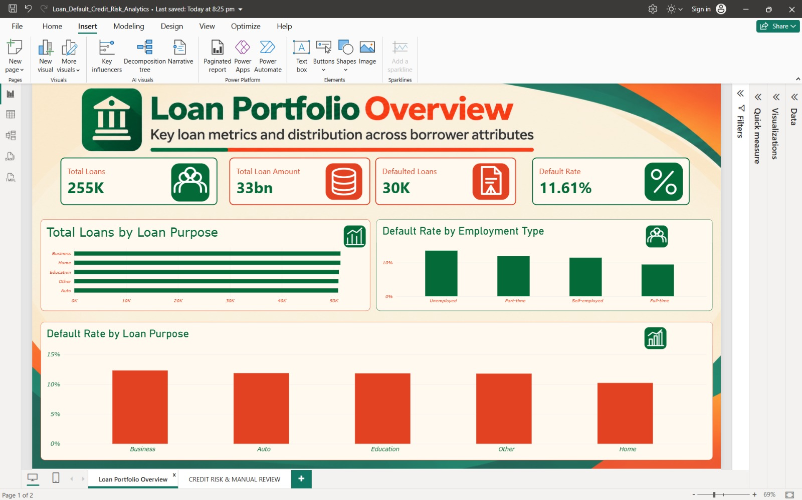
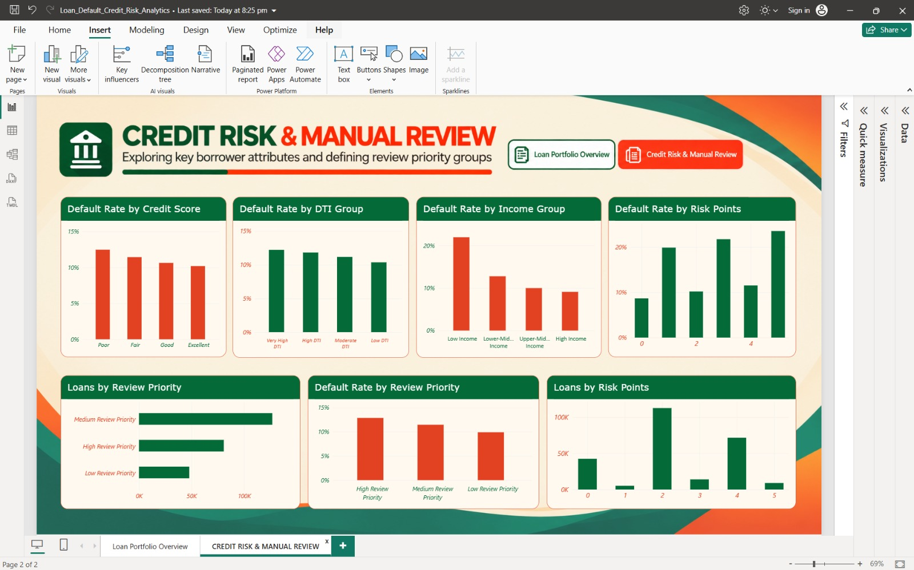

<div align="center">

# 🏦 LOAN DEFAULT & CREDIT RISK ANALYTICS

### Transforming Lending Data into Actionable Credit Risk Intelligence

**An End-to-End Banking & Financial Analytics Portfolio Project**

<br>

[](https://www.python.org/)
[](https://www.mysql.com/)
[](https://powerbi.microsoft.com/)
[](https://pandas.pydata.org/)
[](https://github.com/)

<br>

**255K+ Loan Records | Historical Default Analysis | Interactive Power BI Dashboards**

*An analytical approach to understanding loan portfolio performance, identifying historical default patterns, and supporting transparent risk review.*

[Dashboard](#-dashboard-showcase) •
[Methodology](#-analytical-workflow) •
[Dataset](#-dataset-information) •
[Tech Stack](#-technology-stack) •
[Installation](#-getting-started)

</div>

---

## 📌 Executive Summary

Financial institutions need to understand loan portfolio performance, borrower characteristics, and patterns associated with historical loan defaults.

This project presents an end-to-end **Loan Default & Credit Risk Analytics** solution developed using Python, SQL, MySQL, and Microsoft Power BI.

The project analyzes **255,347 loan records** to explore historical default patterns across credit scores, debt-to-income ratios, employment categories, income levels, and loan purposes.

The analytical workflow includes:

- Data inspection and preprocessing
- Exploratory Data Analysis (EDA)
- Credit risk factor analysis
- SQL-based portfolio analysis
- Rule-based risk segmentation
- Interactive Power BI dashboard development

> **Business Focus:** Identify portfolio segments with elevated historical default rates and provide clear, interpretable information for further manual review.

---

## 📊 Project at a Glance

<div align="center">

| 📁 Total Loans | 📉 Default Rate | ⚠️ Defaulted Loans | 📊 Dashboard Pages |
|:---:|:---:|:---:|:---:|
| **255,347** | **11.61%** | **~30K** | **02** |
| Historical Records | Observed Default Rate | Historical Defaults | Power BI Reports |

</div>

> **Note:** All metrics represent historical observations. They are not predictions of future loan defaults.

---

## 🎯 Business Objectives

The project aims to answer the following business questions:

1. What is the overall performance of the loan portfolio?
2. What percentage of loans have historically defaulted?
3. How do credit scores relate to observed default rates?
4. How does the debt-to-income ratio vary across default segments?
5. Which employment categories show higher historical default rates?
6. How do loan purposes relate to default patterns?
7. How are loans distributed across rule-based risk groups?
8. Which portfolio segments may require additional manual review?

---

## 🖥️ Dashboard Showcase

The Power BI solution contains two analytical report pages designed for portfolio monitoring and credit risk exploration.

### 01 — Loan Portfolio Overview



**Key Performance Indicators**


**Key Performance Indicators**

| KPI | Description |
|---|---|
| Total Loans | Total number of loan records |
| Total Loan Amount | Aggregate loan amount |
| Defaulted Loans | Number of historical defaults |
| Default Rate | Percentage of loans that defaulted |

**Dashboard Visualizations**

- Total Loans by Loan Purpose
- Default Rate by Employment Type
- Default Rate by Loan Purpose

**Business Value**

Provides an overview of lending activity and highlights differences in observed default rates across major portfolio segments.


---

### 02 — Credit Risk & Manual Review



**Purpose:** Explore relationships between borrower characteristics, historical defaults, and rule-based review priorities.

**Dashboard Visualizations**

- Default Rate by Credit Score Group
- Default Rate by DTI Group
- Default Rate by Income Group
- Default Rate by Risk Points
- Loans by Review Priority
- Default Rate by Review Priority
- Loans by Risk Points

**Business Value**

Supports exploratory segmentation and helps identify groups that may warrant additional investigation.


---

### 📂 Dashboard Files

| File | Description |
|---|---|
| [Power BI Dashboard](dashboard/Loan_Default_Credit_Risk_Analytics.pbix) | Editable Power BI report |
| [Dashboard PDF](dashboard/Loan_Default_Credit_Risk_Dashboard.pdf) | Static preview of both pages |

> The `.pbix` file requires Microsoft Power BI Desktop. The PDF can be viewed directly without Power BI.

---

## 🔄 Analytical Workflow

The project follows a structured data analytics pipeline.

```mermaid
flowchart TD
    A[Raw Loan Dataset] --> B[Data Inspection]
    B --> C[Data Cleaning]
    C --> D[Exploratory Data Analysis]
    C --> E[MySQL Data Import]
    E --> F[SQL Analysis]
    D --> G[Risk Factor Analysis]
    F --> H[Power BI Dashboard]
    G --> H
    H --> I[Portfolio Insights]
    H --> J[Manual Review Segmentation]
```



### Phase 01 — Data Inspection

**Tools:** Python, Pandas

- Examined dataset dimensions and column information.
- Reviewed data types and missing values.
- Inspected borrower and loan attributes.
- Explored the distribution of the default target.

**Script:** `src/data_inspection.py`

### Phase 02 — Data Cleaning

**Tools:** Python, Pandas, NumPy

- Prepared the dataset for downstream analysis.
- Reviewed data consistency.
- Generated an analysis-ready dataset.

**Script:** `src/data_cleaning.py`

**Output:** `data/loan_cleaned.csv`

### Phase 03 — Exploratory Data Analysis

**Tools:** Pandas, Matplotlib, Seaborn

Explored the distributions and relationships of:

- Credit Score
- Debt-to-Income Ratio
- Income
- Employment Type
- Loan Purpose
- Historical Default

**Script:** `src/eda_analysis.py`

### Phase 04 — Credit Risk Factor Analysis

Analyzed observed default patterns across selected borrower and loan characteristics.

The analysis focuses on interpreting historical associations rather than predicting individual loan outcomes.

**Script:** `src/risk_factor_analysis.py`

### Phase 05 — SQL & MySQL Analysis

**Tools:** MySQL, SQL, Python

Imported the cleaned loan dataset into MySQL for structured analysis.

**Database:** `loan_risk_analytics`

**Table:** `loans`

SQL analysis includes:

- Portfolio-level aggregation
- Historical default rate calculations
- Loan purpose segmentation
- Employment-based analysis
- Credit risk factor exploration

**Files:**

- `src/mysql_data_import.py`
- `sql/loan_risk_analysis.sql`

### Phase 06 — Business Intelligence

**Tool:** Microsoft Power BI

Developed two analytical dashboard pages using:

- DAX Measures
- KPI Cards
- Interactive Charts
- Categorical Risk Groups
- Rule-Based Review Priorities

---

## 🗂️ Dataset Information

**Dataset:** Loan Default Prediction

**Source:** [Kaggle — nikhil1e9](https://www.kaggle.com/datasets/nikhil1e9/loan-default)

| Attribute | Details |
|---|---|
| Total Records | 255,347 |
| Total Columns | 18 |
| Target Variable | `Default` |
| Original File | `Loan_default.csv` |
| Cleaned File | `loan_cleaned.csv` |
| Domain | Banking & Financial Services |
| Analysis Type | Exploratory / Descriptive Analytics |

The raw and cleaned CSV files are excluded from GitHub to keep the repository lightweight.

Users can download the dataset from the original Kaggle source.

---

## 🧰 Technology Stack

| Category | Technologies | Purpose |
|---|---|---|
| Programming | Python | Data processing and analysis |
| Data Manipulation | Pandas, NumPy | Data preparation |
| Visualization | Matplotlib, Seaborn | Exploratory visualizations |
| Database | MySQL | Structured data storage |
| Query Language | SQL | Portfolio analysis |
| Business Intelligence | Power BI, DAX | Dashboard development |
| Development | VS Code | Project development |
| Version Control | Git, GitHub | Source code management |

---

## 📁 Project Architecture

```text
Loan-Default-Credit-Risk-Analytics/
│
├── dashboard/
│   ├── Loan_Default_Credit_Risk_Analytics.pbix
│   ├── Loan_Default_Credit_Risk_Dashboard.pdf
│   └── screenshots/
│       ├── loan-portfolio-overview.png
│       └── credit-risk-manual-review.png
│
├── data/
│   ├── Loan_default.csv
│   └── loan_cleaned.csv
│
├── demo/
│   └── Loan_Default_Credit_Risk_Demo.mp4
│
├── sql/
│   └── loan_risk_analysis.sql
│
├── src/
│   ├── data_inspection.py
│   ├── data_cleaning.py
│   ├── eda_analysis.py
│   ├── risk_factor_analysis.py
│   └── mysql_data_import.py
│
├── .gitignore
├── requirements.txt
└── README.md
```

**Note:** The CSV files and MP4 demo are stored locally but excluded from the GitHub repository. The screenshot files shown above will be added in the next step.

---

## 🚀 Getting Started

### Prerequisites

- Python 3.x
- VS Code or another Python IDE
- MySQL Server (for database analysis)
- Microsoft Power BI Desktop

### 1. Clone the Repository

```bash
git clone https://github.com/YOUR_USERNAME/YOUR_REPOSITORY.git
cd YOUR_REPOSITORY
```

Replace the placeholder repository URL with the actual GitHub URL after publishing.

### 2. Create a Virtual Environment

**Windows PowerShell:**

```powershell
python -m venv .venv
.\.venv\Scripts\Activate.ps1
```

### 3. Install Dependencies

```powershell
python -m pip install -r requirements.txt
```

### 4. Download the Dataset

Download `Loan_default.csv` from:

https://www.kaggle.com/datasets/nikhil1e9/loan-default

Place the downloaded CSV in the `data/` directory.

### 5. Run the Analysis

Run the Python scripts in sequence:

```powershell
python src/data_inspection.py
python src/data_cleaning.py
python src/eda_analysis.py
python src/risk_factor_analysis.py
```

If necessary, update the local file paths used by the scripts.

### 6. MySQL Integration

Configure your local database connection securely before running:

```powershell
python src/mysql_data_import.py
```

Never commit database passwords or other secrets to GitHub.

### 7. Open the Power BI Dashboard

Open:

```text
dashboard/Loan_Default_Credit_Risk_Analytics.pbix
```

If Power BI asks for the dataset location, update the source path to the cleaned CSV on your computer.

---

## 🧠 Analytical Interpretation

This project uses historical default rates and rule-based segmentation to support exploratory credit risk analysis.

### What the Project Provides

- Historical loan portfolio summaries
- Default rate comparisons across segments
- Exploratory risk factor visualizations
- Rule-based review priority groupings
- Interactive business intelligence reporting

### What the Project Does Not Provide

- A trained default prediction model
- Validated individual credit risk probabilities
- Automated lending decisions
- Evidence of causal relationships

Any real-world lending application would require independent validation, fairness assessment, and appropriate governance.

---

## 🛣️ Future Roadmap

- [x] Data inspection and cleaning
- [x] Exploratory Data Analysis
- [x] Credit risk factor analysis
- [x] MySQL database integration
- [x] SQL-based analysis
- [x] Power BI portfolio dashboard
- [x] Credit Risk & Manual Review dashboard
- [x] Dashboard PDF export
- [x] Screen-recorded project demonstration
- [ ] Add dashboard screenshots to GitHub
- [ ] Develop and validate a predictive model
- [ ] Deploy a live interactive web dashboard

---

## 🎥 Project Demonstration

A screen-recorded walkthrough demonstrates the Power BI report, portfolio KPIs, risk segmentation, and interactive charts.

The demonstration video is intended for LinkedIn portfolio presentation.

The original Power BI file and dashboard PDF are available in the repository.

---

## 📬 Project Highlights

**Domain:** Banking, Financial Services & Insurance (BFSI)

**Project Type:** End-to-End Data Analytics

**Primary Focus:** Loan Default Analysis & Credit Risk Exploration

**Core Skills Demonstrated:**

`Python` · `Pandas` · `NumPy` · `SQL` · `MySQL` · `EDA` · `Power BI` · `DAX` · `Data Visualization` · `Business Intelligence`

---

<div align="center">

### ⭐ Turning Complex Loan Data into Clear Financial Insights

**Built with Python, SQL, MySQL & Power BI**

*Data Analytics | Banking Analytics | Credit Risk Intelligence*

</div>
